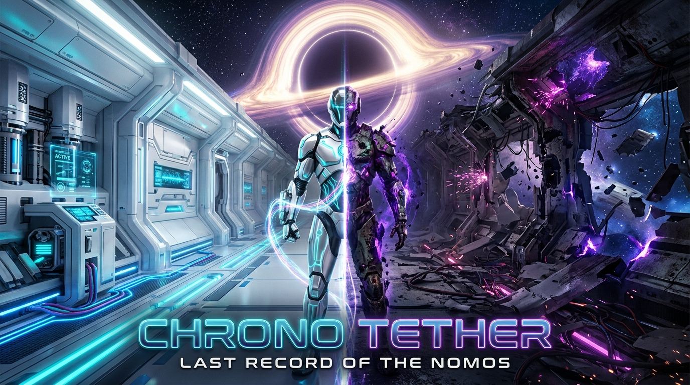

# ⏳ CHRONO TETHER: LAST RECORD OF THE NOMOS
**A Dual-Timeline Sci-Fi Metroidvania Action-Adventure & Emotional Thriller**  
*Developed for the GAME ARENA Hackathon (SVERI Pandharpur / Google Gemini)*  
*Engine:* Pure HTML5 Canvas + Web Audio API (Zero External Asset Dependencies, Runs 100% Offline in Any Browser)  
🎮 **Live Web Demo:** [https://dakaufeeboii.github.io/chrono-tether/](https://dakaufeeboii.github.io/chrono-tether/)  
📦 **Source Code Repository:** [https://github.com/DaKaufeeBoii/chrono-tether](https://github.com/DaKaufeeBoii/chrono-tether)  
🤖 **AI Foundation Model:** **Gemini 3.8 Flash by Google DeepMind**

---



---

## 🌟 The Elevator Pitch (Why Judges Will Love This)

> *"What if your only path forward exists sixty minutes in the future, but the key to opening it was locked sixty minutes in the past?"*

**CHRONO TETHER** is an innovative, high-octane 2D top-down Metroidvania action thriller set aboard a dying interstellar generation colony ship fractured across two overlapping temporal dimensions. With the tap of `[SPACE]` or `[RIGHT CLICK]`, the player seamlessly **phase-shifts reality** between **T-0 (The Pristine Past)** and **T+60 (The Ruined Void)** to dodge projectile barrages, phase through collapsed bulkheads, solve cross-temporal causality puzzles, and uncover the heartbreaking truth behind the ship's catastrophe.

---

## 📖 The Narrative: A Story of Sacrifice and Survival

### The Setting: Year 2394 // The Event Horizon
The colony ship **U.S.S. Nomos** carried 800 cryogenic colonists toward Gliese 667Cc—humanity's final sanctuary following the collapse of Earth's solar grid. While passing micro-singularity *Null-7*, the ship suffered a catastrophic chronal shear. Spacetime fractured into two distinct realities existing at the exact same spatial coordinates:

1. 💠 **T-0 (The Pristine Past - 12 Minutes Before Breach):**
   - Clean, humming cybernetic corridors, glowing cyan floor conduits, and intact high-tech architecture.
   - **Threats:** The ship's automated security grid (`A.T.L.A.S.`) is in hyper-lockdown. Autonomous Sentry Quad-Drones and Pulse Turrets treat you as an intruder.
   - **Obstacles:** Heavy titanium blast doors are locked with biometric clearance, and high-voltage red laser tripwires block hallways.

2. 🔮 **T+60 (The Ruined Void - 60 Minutes After Breach):**
   - The ship is a decaying, oxygen-starved neon-violet wreck drifting on the edge of the black hole.
   - **Threats:** Eldritch temporal horrors (`Void Wraiths` and `Chrono Stalkers`) born from collapsed quantum probabilities roam the ruins.
   - **Opportunities:** The blast doors that were locked in the past have been ripped apart by void fractures! Power conduits leak chronal energy, and shattered walls provide secret passageways.

### The Protagonist: UNIT-7 ("Elena")
You awaken as **UNIT-7**, an emergency maintenance chassis booted by the ship's failing auxiliary core. But as you recover audio logs and memory fragments scattered across the ship, the horrifying truth emerges:
- Captain Vance panicked after receiving distress reports from Earth and forced an illegal warp jump that sheared the ship's temporal manifold.
- Dr. Elena Ward, Chief Temporal Physicist, realized her human body would not survive the lethal radiation leak. In her final moments, she executed a neural transfer into UNIT-7.
- **The Core Objective:** Dr. Ward's 8-year-old daughter, **Maya**, is still alive in **Cryo-Chamber #404** deep within the Singularity Core. To save Maya, you must battle through both timelines across 5 non-linear station decks, overload the Chrono-Pylons, shatter the **Paradox Nexus**, and launch her escape pod to safety!

---

## 🎮 Core Gameplay Mechanics & Metroidvania Arsenal

### 1. Dual-Timeline Phase Shifting (`[SPACE]` or `[RIGHT CLICK]`)
- Seamlessly flips your anchor between **T-0 (Past)** and **T+60 (Future)** in 0.0 seconds.
- **Pre-Shift Collision Safety:** Built-in spatial collision detector blocks shifting if the player's coordinate intersects a solid bulkhead in the destination epoch (`"COLLISION HAZARD! CANNOT PHASE INTO SOLID BULKHEAD!"`).
- **Phase Dodging:** Hostile projectiles belong to the timeline they were fired in! If a heavy plasma volley is incoming in the Past, shift to the Future—the bolts will phase harmlessly through your chassis ("PHASE DODGE!").
- **Bulkhead Phasing:** Stand in front of an impassable titanium blast door in the Past $\rightarrow$ phase to the Future where it was blown open $\rightarrow$ walk through the doorway $\rightarrow$ phase back to the Past on the other side!

### 2. Multi-Tier Weapon Arsenal
- **Tier 1 — Kinetic Plasma Blaster:** Standard issue high-velocity energy rounds.
- **Tier 2 — Chrono Scatter Tri-Beam:** 3-way spreading energy bursts (acquired from Maintenance Overseer).
- **Tier 3 — Tachyon Continuous Railgun:** High-penetration linear beam (acquired from Grav-Goliath).
- **Tier 4 — Void Singularity Cannon:** Cosmic singularity projectile with gravitational vortex collapse (acquired in Deck 5).
- **Overcharge Piercing Beam (Hold [LEFT CLICK]):** Release to unleash a massive white-hot laser beam that pierces through walls and enemies in **both timelines simultaneously**!

### 3. Ability-Gated Powerups
- **Tachyon Grapple (`[F]`):** Latches onto glowing magnetic tether anchors to zip across bottomless chasms and acid lakes at 950 px/s with forward momentum carry-over.
- **Chronal EMP Disruption Grenade (`[Q]`):** Remote explosive that destabilizes magnetic energy barriers, detonates cracked walls, and neutralizes enemy shields.
- **Quantum Portal Weaver (`[R]`):** Places paired bidirectional micro-wormholes that teleport player, bullets, and momentum across obstacles.
- **Phase-Dash Matrix (`[SHIFT]`):** Upgrades dash with total invulnerability frames to phase straight through lethal electrified laser grids.
- **Chronal Spectral Visor (`[V]`):** Reveals invisible platforms, dimensional anomalies, and secret cracked bulkhead cracks.
- **HP Expansion Tanks & Chrono Tanks:** 8 hidden canisters expanding max hull health and energy capacity by +25 each.

### 4. Dimension-Breaking Causality Puzzles
- **Temporal Botanical Causality:** Planting a Tachyon Hydro-Spore in the Pristine Past ($T-0$) triggers 60 years of rapid growth in the Ruined Void ($T+60$), creating a massive climbable vine bridge across an impassable acid lake.
- **Remote EMP Circuit Switching:** Throwing EMP grenades through temporal rifts in the Past disables high-voltage energy barriers locking gates in the Future.

### 5. Persistent Save Stations & World Map
- **Save Stations:** Dedicated neural anchor stations (`localStorage['chrono_tether_save_v1']`) across each deck that restore hull health, energy, and reload EMP grenades.
- **Continue Mission Loader:** The title screen automatically detects saved progress and displays `CONTINUE MISSION [SAVE FOUND]` to resume instantly.
- **Minimap HUD & Fullscreen Map (`[M]` / `[TAB]`):** Interactive 5-deck room grid with color-coded markers for explored rooms, save pods `[S]`, upgrade vaults `[?]`, elevators `[O]`, and boss arenas `[!]`.

---

## 🗺️ Campaign Progression (5 Interconnected Station Decks)

| Deck | Name | Mission & Hazards | Key Ability / Boss Encounter |
|---|---|---|---|
| **Deck 1** | **Cryo-Stasis Hub** | Awaken from cold storage, learn phase mechanics, bypass security lockdown. | **Mini-Boss: Maintenance Overseer Mech**<br>• Seismic slam shockwaves & arc mines.<br>• *Reward:* Chrono Scatter Tri-Beam. |
| **Deck 2** | **Hydro-Silos & Biolab** | Navigate toxic acid trenches, plant hydro-spores across time, solve causality puzzles. | **Mini-Boss: Bio-Grafted Chrono-Flora**<br>• Acid spit spreads & 360° thorn needles.<br>• *Reward:* Tachyon Grapple (`[F]`) & +25 Chrono Tank. |
| **Deck 3** | **Tachyon Grav-Labs** | Inverted gravity corridors, magnetic rail platforming, remote EMP barrier puzzles. | **Mini-Boss: Grav-Goliath Titan**<br>• Graviton shock beam & gravity well collapse.<br>• *Reward:* EMP Grenades (`[Q]`) & Tachyon Railgun. |
| **Deck 4** | **Sub-Hull Void Rift** | Vacuum drift platforming, outer space exposure, electrified laser grids. | **Vault Upgrades:**<br>• Phase-Dash Matrix (`[SHIFT]`)<br>• Spectral Visor (`[V]`)<br>• Reality Bleed Chasm navigation. |
| **Deck 5** | **Singularity Crucible** | The Event Horizon. Face the manifested temporal anomaly guarding Cryo-Chamber #404. | **CLIMAX BOSS: THE PARADOX NEXUS (3 Phases)**<br>• Overload 4 Chrono-Pylons across Past & Future.<br>• Phase 2: Unbound Singularity bullet-hell.<br>• Phase 3: Spacetime collapse & Maya's rescue! |

---

## 🕹️ Controls

| Action | Primary Input | Alternative Input |
|---|---|---|
| **Move / Thruster** | `W`, `A`, `S`, `D` | Arrow Keys |
| **Aim** | Mouse Reticle | — |
| **Fire Blaster (Hold to Charge)** | **Left Mouse Button** | — |
| **Phase Shift (Toggle Timeline)** | **Spacebar** | **Right Mouse Button** |
| **Thruster Dash (I-Frames)** | **Left Shift** | `ShiftRight` |
| **Tachyon Grapple Tether** | **`F`** | — |
| **Chronal EMP Grenade** | **`Q`** | — |
| **Quantum Portal Weaver** | **`R`** | — |
| **Spectral Visor Toggle** | **`V`** | — |
| **Interact / Save / Advance Text** | **`E`** | Spacebar / Click Dialogue Box |
| **Toggle World Map** | **`M`** | `Tab` / Map Button (Top-Right) |
| **Pause Game** | **`Escape`** | — |
| **Toggle Audio** | Audio Button (Top-Right) | — |

---

## 🎧 Procedural Web Audio Synthesizer (Zero External Files!)

The entire soundtrack and all 11 sound effects are **100% procedurally synthesized in real-time** using the native browser **Web Audio API**:
- **Adaptive Music Engine:** Generates retro synthwave arpeggios, driving kick/snare rhythms, and warm analog chord progressions.
- **Dynamic Reality Timbre Filter:**
  - In **T-0 (Past)**: Audio filter opens up to `14,000 Hz` (bright, high-tech neon shimmer, clear leads).
  - In **T+60 (Future)**: Audio filter exponentially ramps down to `650 Hz` with heavy $Q=4.0$ resonance (muffled, suffocating void drone, eerie sub-bass).
- **Procedural SFX:**
  - Pitch-ramping plasma blaster shots with harmonic overtones.
  - Sub-bass phase-shift whoosh with reality tear sweeps.
  - White-noise filtered explosion rumbles and dash windbursts.
  - High-tech terminal arpeggios and character voice chirps.

---

## 🚀 How to Run the Game

### Instant Browser Play:
Play directly online at: **[https://dakaufeeboii.github.io/chrono-tether/](https://dakaufeeboii.github.io/chrono-tether/)**

Or open `index.html` locally in any modern browser (Chrome, Edge, Firefox, Safari, Brave):
```powershell
# Double-click index.html or launch from terminal:
Start-Process "index.html"
```

### Local Web Server (Recommended):
```powershell
# Run with Python:
python -m http.server 8080

# Or with Node:
npx serve .
```
Then navigate to: **`http://localhost:8080`**

---

## 🏆 Hackathon Quality Highlights
1. **Zero External Dependencies:** No NPM packages to build, no external CDNs that can fail offline, no broken image/audio links.
2. **60 FPS Hardware-Accelerated Canvas:** Smooth sub-pixel camera tracking, mouse lookahead, trauma-based screen shake, and glitch post-processing shaders.
3. **Full 1-Hour+ Metroidvania Campaign:** 5 non-linear decks, 3 mini-bosses, 1 multi-phase climax boss, persistent save stations, causality puzzles, and emotional narrative arc.
4. **Verifiable AI Attribution:** Complete audit trail in `PROOF_OF_AI_GENERATION.md` attributing **Gemini 3.8 Flash by Google DeepMind**.
